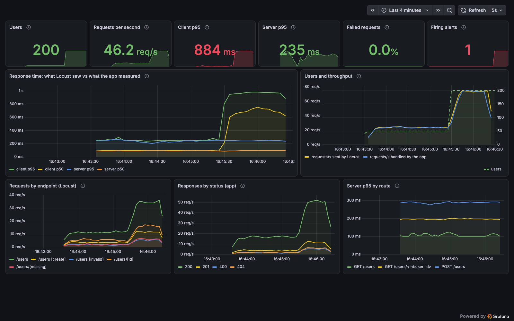
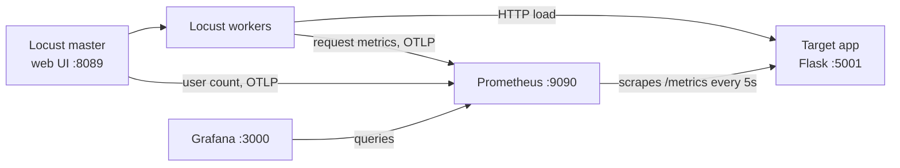

# Load Testing & Observability with Locust, Prometheus and Grafana

Distributed load testing with Locust against a sample Flask API, with the client's view and the server's view of the same test on one Grafana dashboard, all in one Docker Compose stack.

[](https://github.com/yashwant-das/qa-py-locust-grafana/actions/workflows/load-test.yml)
[](LICENSE)
[](https://www.python.org)
[](https://locust.io)
[](https://prometheus.io)
[](https://grafana.com)



## Why it exists

A load test result is only useful next to what the system was doing at the time. Locust reports what each simulated user experienced. The app reports how long it spent handling each request. This repo puts both on one dashboard, so the gap between them is visible.

The spike scenario above shows why that matters. At 200 users, Locust's p95 response time climbs to about one second while the app still reports about 240 ms. The requests are waiting in a queue for one of the app's 8 worker threads, and the app's own numbers cannot show time spent before a request reaches it.

What this project demonstrates:

- Distributed Locust workers with built-in OpenTelemetry export, without a separate exporter.
- Client and server measurements on one provisioned dashboard, exposing queueing hidden from handler timings.
- Expected-negative API requests that count as successes, alongside configurable latency/failure gates.
- A complete local stack and reproducible gated load test, with service-free quality checks in GitHub Actions.

## Architecture



Locust workers send load to the target app and push their own request metrics to Prometheus over OpenTelemetry (`locust --otel`). Prometheus also scrapes the app's `/metrics` endpoint and evaluates the alert rules. Grafana reads from Prometheus through a provisioned datasource and dashboard.

## Quickstart

Prerequisites: Docker with Compose v2, and free ports 3000, 5001, 8089 and 9090. Local Python verification uses Python 3.13; the Docker quickstart needs no local Python installation.

```bash
git clone https://github.com/yashwant-das/qa-py-locust-grafana.git && cd qa-py-locust-grafana
docker compose up --build -d --wait
```

A 20-user test starts by itself. Open <http://localhost:3000> and the dashboard is already moving. No login or setup is needed.

| Service | URL | Notes |
| --- | --- | --- |
| Grafana | <http://localhost:3000> | Opens on the dashboard with anonymous read-only access. Sign in as `admin` / `admin` to edit. |
| Locust web UI | <http://localhost:8089> | Stop the test, or start a new one with a different user count |
| Prometheus | <http://localhost:9090> | Queries, targets and alerts |
| Target app | <http://localhost:5001> | The `/users` API, `/health` and `/metrics` |

All four ports are bound to `127.0.0.1` only. Add workers with `docker compose up -d --scale locust-worker=4`. Stop everything with `docker compose down`.

### Scenarios

| Scenario | File | What it does |
| --- | --- | --- |
| Steady load (default) | `locustfiles/steady.py` | 20 users reading and creating users, including an expected 404 and an expected 400 |
| Spike | `locustfiles/spike.py` | The same users on a repeating 5-minute shape: 2 minutes at 50 users, 1 minute at 200, 2 minutes at 10 |

Switch scenario with the `LOCUSTFILE` variable:

```bash
LOCUSTFILE=spike.py docker compose up -d
```

About two and a half minutes in, the spike pushes Locust's p95 past 500 ms and the `HighClientLatency` alert fires.

## Test reports and results

Cloud CI runs unit tests, lint, formatting, type checking and documentation/configuration checks on every push and pull request. Docker services and Locust load runs execute locally.

After the [developer setup](docs/development.md#setup), run the complete local verification:

```bash
bash scripts/verify-stack.sh
```

It starts the full stack, checks that Locust and app metrics reach Prometheus and that Grafana has loaded the dashboard, then runs a 60-second, 20-user headless test. The gate fails if p95 exceeds 500 ms or more than 1% of requests fail. The script stops its own stack when it finishes.

Results are written locally to `reports/locust-summary.md`, `reports/locust-report.html` and `reports/locust_*.csv`. [Quality check runs](https://github.com/yashwant-das/qa-py-locust-grafana/actions/workflows/load-test.yml) show the cloud checks; load reports are generated by the local run.

The thresholds are command-line options added by `steady.py`, so the same gate runs locally against the stack:

Stop the autostarted test in the Locust UI (or with `curl -f http://localhost:8089/stop`) before running this standalone gate, so the two loads do not compete.

```bash
pip install -r requirements-dev.txt
locust -f locustfiles/steady.py --headless --users 20 --spawn-rate 5 --run-time 60s \
  --host http://localhost:5001 --max-p95-ms 500 --max-fail-ratio 0.01 --html report.html
```

### Offline verification

After the [developer setup](docs/development.md#setup), check Python and documentation without starting Docker:

```bash
uv run --locked --no-sync ruff check .
uv run --locked --no-sync ruff format --check .
uv run --locked --no-sync mypy target-app locustfiles
uv run --locked --no-sync pytest -q
uv run --locked --no-sync pre-commit run --all-files
```

These checks cover code, API/metrics behavior, threshold exits and maintained documentation. The separate local stack check verifies Docker wiring, telemetry delivery and the controlled load gate. See [development](docs/development.md) for configuration, quality gates, local reports and troubleshooting.

### Dashboard and alerts

There is one dashboard, **Load test: client vs server**. It shows users, request rate, p50 and p95 from both sides, failed requests and firing alerts, with breakdowns by endpoint, status code and route.

Alert rules live in `grafana/prometheus/alert_rules.yml`:

| Alert | Fires when |
| --- | --- |
| `TargetAppDown` | Prometheus cannot scrape the app for 15 seconds |
| `HighServerErrorRate` | More than 5% of the app's responses are 5xx for 15 seconds |
| `HighClientLatency` | Locust's p95 response time is above 500 ms for 15 seconds |

Firing alerts show on the dashboard and at <http://localhost:9090/alerts>. There is no Alertmanager, so nothing is sent anywhere.

## Tech stack

| Layer | Tool | Version | Why |
| --- | --- | --- | --- |
| Load generation | Locust, master and workers | 2.46.7 | Python scenarios, distributed load, built-in OpenTelemetry export |
| Target app | Flask on gunicorn, prometheus-client | 3.1.3, 26.2.0, 0.26.0 | Small API with a latency histogram per method, route and status |
| Metrics | Prometheus | 3.15.0 | Scrapes the app, receives Locust's metrics over OTLP, evaluates alert rules |
| Dashboards | Grafana | 13.2.3 | Provisioned datasource and dashboard |
| Orchestration | Docker Compose, GitHub Actions | v2 | Local stack and gated load tests; service-free quality checks in CI |
| Language | Python | 3.13 | Target app, scenarios and tests |

## Project structure

```text
├── locustfiles/
│   ├── steady.py            # The user behaviour and the pass/fail thresholds
│   └── spike.py             # The same users with a repeating spike shape
├── target-app/              # Flask API with /health and /metrics
├── tests/                   # Unit tests for the app and the thresholds
├── grafana/
│   ├── dashboards/          # The dashboard JSON
│   ├── provisioning/        # Datasource and dashboard provisioning
│   └── prometheus/          # prometheus.yml and alert_rules.yml
├── docker-compose.yml
├── requirements-dev.txt     # Locust, pytest and quality tools for local runs and CI
├── scripts/verify-stack.sh  # Local stack, telemetry and gated load verification
├── pyproject.toml           # Python baseline, direct dependencies and tool settings
├── AGENTS.md                # Agent guidance
└── docs/                    # Architecture, development and historical design records
```

## Documentation

| Guide | Contents |
| --- | --- |
| [Architecture](docs/architecture.md) | Service lifecycles, metric sources/units, queueing boundaries and provisioning |
| [Development](docs/development.md) | Setup, overrides, extending scenarios, gates, troubleshooting and verification evidence |
| [Historical stack design](docs/superpowers/plans/2026-10-12-simplify-load-test-stack.md) | Original implementation rationale, commands and dated observations; retained as history |

## License

MIT. See [LICENSE](LICENSE).
