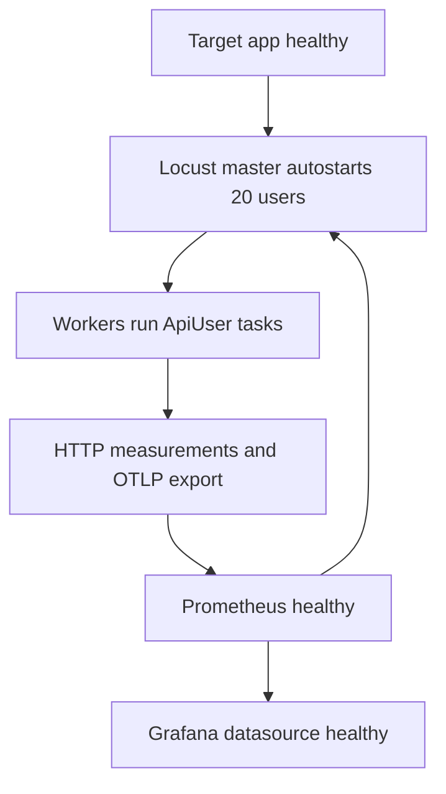

# Architecture

The stack compares what a load generator experienced with what the target API
measured inside its handlers. The [README](../README.md) contains the runnable
overview and original spike screenshot; this guide explains the contracts behind it.

## Components and startup

| Service | Responsibility | Boundary |
| --- | --- | --- |
| `target-app` | Flask API served by one gunicorn process with eight threads | Internal `:5000`, loopback `:5001`; health and Prometheus endpoints |
| `locust-master` | Coordinates users, serves UI, exports user count over OTLP | Loopback `:8089`; 20 users autostart at five users/second |
| `locust-worker` | Runs shared API tasks and exports request measurements | Scalable containers; HTTP to target, OTLP to Prometheus |
| `prometheus` | Scrapes API, receives OTLP, evaluates three alert rules | Internal/loopback `:9090` |
| `grafana` | Queries the provisioned datasource and displays one 11-panel dashboard | Loopback `:3000`; anonymous Viewer, admin login for editing |



Compose waits for the app and Prometheus health checks before starting the master.
Workers depend on the master. Grafana's health check tests the provisioned
Prometheus datasource, not just the web server. There are no named persistence
volumes: this is a disposable demo stack, not a durable metrics service.

## Requests, queueing and state

```mermaid
sequenceDiagram
    participant User as Locust user
    participant Pool as Gunicorn thread pool
    participant App as Flask handler
    participant Prom as Prometheus
    User->>Pool: HTTP request; client clock starts
    Note over Pool: Requests can queue before a handler runs
    Pool->>App: An available thread starts the handler
    App->>App: Start timer, simulate work, read or change users
    App->>App: Record handler duration and status
    App-->>User: Response; client clock stops
    Prom->>App: Scrape metrics every 5 seconds
    User->>Prom: Export client metrics over OTLP every 5 seconds
```

The app's `before_request`/`after_request` timer cannot measure waiting before a
thread starts the request. At 200 users, the original demonstration shows client
p95 around one second while handler p95 stays around 240 ms. These are observed
demo values, not portable performance guarantees. Keep gunicorn's one process,
eight threads and five-second keep-alive: one process also keeps metrics in a
single registry, while keep-alive outlasts the users' 1–3 second pauses.

`ApiUser` uses task weights 6/3/2/1/1 for listing, fetching, creating, missing and
invalid users. The five stable request names are `/users`, `/users/[id]`,
`/users [create]`, `/users/[missing]` and `/users [invalid]`. Expected 404 and 400
responses are marked successful; unexpected statuses in those tasks fail.

The API seeds users 1–5, never evicts them and caps the store at 1,000 entries by
evicting the oldest non-seed user. IDs increase monotonically; ID 0 never exists.
Creation and list snapshots use a lock. Routes expose list pagination, retrieval,
creation, `/`, `/health` and `/metrics`; bad bodies and pagination return 400.
List work takes 50–100 ms, fetch work 50–200 ms and creation 100–300 ms. Unit tests
replace simulated work to avoid sleeping.

## Metrics and units

| Metric family | Source | Labels used | Purpose |
| --- | --- | --- | --- |
| `locust_users_count` | Master, OTLP | `user_class` | Current total user count |
| `locust_client_duration_seconds_count` | Workers, OTLP | `name`, `error_type` on failures | Endpoint rates and Locust failure ratio |
| `http_client_duration_milliseconds_bucket` / `_count` | Workers, requests instrumentation over OTLP | `http_method`, `http_status_code`, `le` for buckets | Client percentiles and throughput |
| `app_http_request_duration_seconds_bucket` / `_count` | API, scrape | `method`, `route`, `status`, `le` for buckets | Handler percentiles, status rates and 5xx ratio |
| `app_http_requests_in_flight` | API, scrape | None | Requests being handled |

Client percentiles use `http_client_duration_milliseconds_bucket`. In the retained
Locust compatibility set, its own duration histogram records seconds against
default millisecond-scale bucket bounds, placing requests in the first bucket;
`locust_client_duration_seconds_bucket` is therefore unsuitable for percentiles.
Its `_count` remains useful. Server histogram quantiles are multiplied by 1,000
for display in milliseconds. Recheck these assumptions when upgrading instrumentation.

Each worker needs a separate OTLP `instance` identity so its counters do not
overwrite another worker's series. The master reports users once; scaling workers
must not multiply user totals. Validate two active worker identities after changes.

The app excludes `/metrics` and `/health` from duration/in-flight accounting.
Matched routes use route templates; unknown paths share the label `unmatched`,
preventing unbounded series creation from arbitrary URLs. Histogram bounds in
seconds are 0.025, 0.05, 0.075, 0.1, 0.15, 0.2, 0.3, 0.5, 1 and 2.5.

## Telemetry and provisioning

Workers and master use `--otel`, HTTP/protobuf, and endpoint
`http://prometheus:9090/api/v1/otlp/v1/metrics`. Export interval is 5,000 ms;
trace/log exporters are disabled. Prometheus enables its OTLP receiver and uses
`UnderscoreEscapingWithSuffixes`, turning `locust.users.count` into
`locust_users_count`. Scraping and rule evaluation run every five seconds.

Grafana datasource UID `prometheus` points to `http://prometheus:9090` with a
five-second time interval. Dashboard UID `load-test`, title **Load test: client vs
server**, refreshes every five seconds and initially shows the last 15 minutes.

Provisioning mounts at `/etc/grafana/provisioning`; dashboard JSON mounts separately
at `/var/lib/grafana/dashboards`. Combining those mounts previously hid the
dashboard provider. Background plugin preinstallation is disabled because it
briefly unregistered the bundled Prometheus datasource during an update.

| Panel | What it shows |
| --- | --- |
| Users | Master-reported running users |
| Requests per second | All-worker client throughput |
| Client p95 | Client latency including queueing |
| Server p95 | Handler latency, converted to ms |
| Failed requests | Locust failures; expected 400/404 excluded |
| Firing alerts | Prometheus firing-alert count |
| Response time: what Locust saw vs what the app measured | Client/server p50 and p95 on the same time axis |
| Users and throughput | Users on the right axis, client and server request rates |
| Requests by endpoint (Locust) | Rates by stable request name |
| Responses by status (app) | App response rate by HTTP status |
| Server p95 by route | Handler p95 by method and route template |

Client/server stat panels turn orange at 300 ms and red at 500 ms. Failure share
turns red at 1%; the firing-alert panel turns red at one. Dashboard rates use
`$__rate_interval`; alerts use explicit windows, so their values need not match
instantaneously. Missing failures/alerts fall back to zero in their display panels.

## Alerts and boundaries

The [rules](../grafana/prometheus/alert_rules.yml) hold each condition for 15 seconds:
target scrape failure; server 5xx share above 5% over 30 seconds; client p95 above
500 ms over 30 seconds. Prometheus evaluates them and exposes `ALERTS`; Grafana
displays firing counts. There is no Alertmanager or outbound notification channel.

The bundled target and all service ports are local demo boundaries. Docker image
pulls and dependency installation require network access; normal stack operation
needs no paid service, cloud account or external API. No collector, separate
exporter, tracing backend, database or notification service is needed.

## Source layout

`locustfiles/` contains behavior and shape, `target-app/` the standalone build
context, `grafana/` dashboard/provisioning/Prometheus config and `tests/` behavioral
checks. The root manifest records direct dependencies and tool settings; pinned
requirements preserve pip and Docker entry points while uv locking remains pending.
See [development](development.md)
for execution, extension and verification details, and the [historical design
record](superpowers/plans/2026-10-12-simplify-load-test-stack.md) for original experiments.
