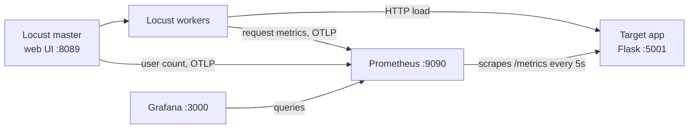

# Simplify the Load Test Stack Implementation Plan

> **For agentic workers:** REQUIRED SUB-SKILL: Use superpowers:executing-plans to implement this plan task-by-task, inline in one session. Yash does not want subagents on this project unless he asks for them. Steps use checkbox (`- [ ]`) syntax for tracking.

**Goal:** Cut the repo to the files that do something, and make its headline promise true: one `docker compose up` shows what Locust saw next to what the app measured, on one Grafana dashboard, with no setup.

**Architecture:** Locust (master and workers, official `locust-otel` image) pushes its own metrics to Prometheus over OTLP using the built-in `--otel` flag. Prometheus also scrapes a latency histogram from the Flask target app, which now runs on gunicorn. Grafana provisions one datasource and one dashboard from files and opens on that dashboard with anonymous read-only access. CI starts the whole stack, proves the wiring, and gates on latency and failure thresholds.

**Tech Stack:** Python 3.13, Locust 2.46.7, Flask 3.1.3, gunicorn 26.2.0, prometheus-client 0.26.0, Prometheus 3.15.0, Grafana 13.2.3, Docker Compose v2, GitHub Actions, pytest 9.1.1.

**Spec:** There is no separate spec file. The design was agreed in conversation on 2026-10-12 and is summarized in "Design summary" below. Every file in this plan was prototyped and run on 2026-10-12 (pytest, a full Docker stack, a spike cycle and the CI steps), so the "Expected" outputs are observed results, not predictions.

## Design summary

**What a visitor gets.** `docker compose up --build -d --wait`, then <http://localhost:3000> opens on a live dashboard. A 20-user test autostarts, so the graphs are already moving. No login, datasource setup or dashboard import.

**The story the dashboard tells.** The target app runs on gunicorn with 1 process and 8 threads. In the spike scenario (200 users) demand exceeds what 8 threads can serve, so requests queue before the app sees them. Observed on 2026-10-12: Locust's p95 rose to 900-1250 ms while the app's own p95 stayed near 240 ms, and the `HighClientLatency` alert fired about 25 seconds into the spike.

**Metrics and where they come from.**

| Prometheus metric | Source | Labels used |
| --- | --- | --- |
| `locust_users_count` | Locust master, OTLP | `user_class` |
| `locust_client_duration_seconds_count` | Locust workers, OTLP | `name`, `error_type` (only on failures) |
| `http_client_duration_milliseconds_bucket` / `_count` | Locust workers, OTLP (requests instrumentation) | `http_method`, `http_status_code`, `le` |
| `app_http_request_duration_seconds_bucket` / `_count` | Target app, scraped | `method`, `route`, `status`, `le` |
| `app_http_requests_in_flight` | Target app, scraped | none |

Client percentiles come from `http_client_duration_milliseconds_bucket`. `locust_client_duration_seconds_bucket` is not usable for percentiles: Locust records it in seconds against the SDK's default millisecond-scale bucket bounds, so every request lands in the first bucket. Its `_count` is correct and is used for per-endpoint rates and the failure ratio.

**What is deleted and why.**

| Deleted | Reason |
| --- | --- |
| `grafana/dashboards/locust_dashboard.json` | Queried `locust_*` metrics that nothing exported |
| `grafana/dashboards/infrastructure_dashboard.json` | Prometheus monitoring itself |
| `grafana/dashboards/performance_metrics_dashboard.json` | Replaced by the single new dashboard |
| `grafana/provisioning/notifiers/` | Legacy alerting format, removed in Grafana 11 |
| `Dockerfile`, `requirements.txt` | Replaced by the official `locustio/locust-otel` image |
| `validate_framework.py` | Replaced by Compose health checks and the CI wiring check |
| `.env.example` | None of its variables were read by anything |
| `locustfiles/scenarios/` | Three files repeating the same tasks, replaced by `steady.py` and `spike.py` |

**Bug fixed along the way.** Today `docker-compose.yml` mounts `./grafana/dashboards` on top of `/etc/grafana/provisioning/dashboards`, which hides `dashboard.yml`. Listing that directory inside the Grafana image shows only the three JSON files, so no dashboard provider is configured. The new layout mounts dashboards at `/var/lib/grafana/dashboards`.

## Global Constraints

- Python 3.13 everywhere we choose the version: the target app image (`python:3.13-slim`), CI (`python-version: "3.13"`) and the local virtualenv. The Locust image ships Python 3.13.16.
- Pin exact versions, never `latest`: `locustio/locust-otel:2.46.7`, `prom/prometheus:v3.15.0`, `grafana/grafana:13.2.3`, `flask==3.1.3`, `gunicorn==26.2.0`, `prometheus-client==0.26.0`, `locust==2.46.7`, `pytest==9.1.1`, `actions/checkout@v7`, `actions/setup-python@v7`, `actions/upload-artifact@v7`.
- Published ports bind to `127.0.0.1` only: 3000, 5001, 8089, 9090.
- Five containers from four tools: `target-app`, `locust-master`, `locust-worker`, `prometheus`, `grafana`. Do not add Alertmanager, tracing, a database or exporters.
- The folder layout stays: `locustfiles/`, `target-app/`, `grafana/{dashboards,provisioning,prometheus}/`.
- Work on branch `simplify-stack`. Commit messages are plain imperative sentences, matching the existing history, and end with the `Co-Authored-By` trailer shown in each commit step.
- On this machine `docker` is installed at `~/.docker/bin`. If a shell reports `command not found: docker`, run `export PATH="$PATH:$HOME/.docker/bin"` first.
- Lines of Python stay within 120 characters.

## Review Focus

Conditions the design implies that are easy to miss. Each one has a test or a verification step in the task that owns it.

1. **A gated run that makes zero requests must fail, not pass.** With no requests, p95 is 0 and the failure ratio is 0, which would read as a pass. Tests: `test_a_run_with_no_requests_is_a_breach` and `test_a_gated_run_with_no_requests_exits_one` (Task 2).
2. **A few failures inside the allowed ratio must exit 0.** Locust exits 1 on any failed request by default, which would make `--max-fail-ratio 0.01` meaningless. Test: `test_failures_within_the_allowed_ratio_exit_zero` (Task 2).
3. **Odd request bodies must get a 400, not a 500.** A non-string `name`, a JSON array or a non-JSON body crashed the old handler's `.strip()` call. Tests: `test_rejects_invalid_user` and `test_rejects_non_json_body` (Task 1).
4. **Unknown URLs must not create unbounded label values.** A scanner hitting random paths would otherwise create one time series per path. Test: `test_unknown_paths_share_one_route_label` (Task 1).
5. **A stack left running for days must not grow without bound.** The test autostarts and never stops, and every `POST /users` adds a user. Test: `test_user_store_is_capped_and_keeps_seeds` (Task 1).
6. **Scaling workers must not corrupt Locust's metrics.** Each worker pushes the same metric names; they stay separate only because each process gets its own `instance` label. Verification: the two-worker check in Task 3, Step 9.

---

## File Structure

| File | Action | Responsibility |
| --- | --- | --- |
| `target-app/app.py` | Rewrite | The API under test, with a latency histogram |
| `target-app/requirements.txt` | Rewrite | Pinned runtime dependencies of the app |
| `target-app/Dockerfile` | Rewrite | Python 3.13 image running gunicorn |
| `requirements-dev.txt` | Create | Locust and pytest for local runs and CI |
| `pytest.ini` | Create | Puts `target-app/` and `locustfiles/` on the import path |
| `tests/test_app.py` | Create | Unit tests for the API and its metrics |
| `tests/test_thresholds.py` | Create | Unit tests for the pass/fail gate |
| `locustfiles/steady.py` | Create | The user behaviour and the thresholds |
| `locustfiles/spike.py` | Create | The same users with a repeating spike shape |
| `docker-compose.yml` | Rewrite | The five containers and their wiring |
| `grafana/prometheus/prometheus.yml` | Rewrite | Scrape config and OTLP naming |
| `grafana/prometheus/alert_rules.yml` | Rewrite | Three rules on metrics that exist |
| `grafana/provisioning/datasources/prometheus.yml` | Rewrite | One datasource with a fixed uid |
| `grafana/provisioning/dashboards/dashboard.yml` | Rewrite | Dashboard provider pointing at the new mount |
| `grafana/dashboards/load_test.json` | Create | The single dashboard |
| `.github/workflows/load-test.yml` | Rewrite | Unit tests, wiring check, gated load test |
| `.gitignore` | Rewrite | Only the entries this repo needs |
| `README.md` | Rewrite | Matches the new stack, adds a screenshot |
| `docs/dashboard.png` | Create | Screenshot used by the README |

Deleted: `Dockerfile`, `requirements.txt`, `validate_framework.py`, `.env.example`, `locustfiles/scenarios/` (3 files), `grafana/provisioning/notifiers/` (1 file), and the three old dashboards.

---

### Task 1: Target app with real metrics

**Files:**
- Create: `requirements-dev.txt`, `pytest.ini`, `tests/test_app.py`
- Rewrite: `target-app/app.py`, `target-app/requirements.txt`, `target-app/Dockerfile`

**Interfaces:**
- Consumes: nothing.
- Produces: an HTTP API on port 5000 with `GET /`, `GET /health`, `GET /metrics`, `GET /users`, `GET /users/<int:user_id>`, `POST /users`. Seed users have IDs 1-5 and are never evicted; ID 0 never exists. Metrics: `app_http_request_duration_seconds` (histogram; labels `method`, `route`, `status`) and `app_http_requests_in_flight` (gauge). `/metrics` and `/health` are not measured. Module attributes used by tests: `app`, `users`, `SEED_NAMES`, `MAX_USERS`, `simulate_work(low, high)`.

- [ ] **Step 1: Create the branch and the dependency files**

```bash
git switch -c simplify-stack
```

Write `target-app/requirements.txt`:

```text
flask==3.1.3
gunicorn==26.2.0
prometheus-client==0.26.0
```

Write `requirements-dev.txt`:

```text
-r target-app/requirements.txt
locust==2.46.7
pytest==9.1.1
```

Write `pytest.ini`:

```ini
[pytest]
pythonpath = target-app locustfiles
testpaths = tests
```

Create the virtualenv (`.venv/` is already ignored by git):

```bash
uv venv --python 3.13 .venv
uv pip install --python .venv/bin/python -r requirements-dev.txt
```

Expected: `.venv/bin/locust --version` prints `locust 2.46.7 ... (Python 3.13.x)`.

- [ ] **Step 2: Write the failing tests**

Write `tests/test_app.py`:

```python
import pytest
from prometheus_client import REGISTRY

import app as target


@pytest.fixture
def client(monkeypatch):
    monkeypatch.setattr(target, "simulate_work", lambda low, high: None)
    return target.app.test_client()


def request_count(method, route, status):
    labels = {"method": method, "route": route, "status": status}
    return REGISTRY.get_sample_value("app_http_request_duration_seconds_count", labels) or 0


def test_lists_seed_users(client):
    body = client.get("/users?per_page=5").get_json()
    assert [user["name"] for user in body["users"]] == target.SEED_NAMES


def test_rejects_bad_pagination(client):
    assert client.get("/users?per_page=0").status_code == 400
    assert client.get("/users?page=0").status_code == 400


def test_missing_user_is_404(client):
    assert client.get("/users/0").status_code == 404


def test_creates_user(client):
    response = client.post("/users", json={"name": "  Grace  ", "email": "grace@example.com"})
    assert response.status_code == 201
    created = response.get_json()["user"]
    assert created["name"] == "Grace"
    assert client.get(f"/users/{created['id']}").get_json()["user"] == created


@pytest.mark.parametrize(
    "payload",
    [{}, {"name": ""}, {"name": 42}, {"name": "Grace", "email": "not-an-email"}, {"name": "Grace", "email": 7}, ["Grace"], "Grace"],
)
def test_rejects_invalid_user(client, payload):
    assert client.post("/users", json=payload).status_code == 400


def test_rejects_non_json_body(client):
    assert client.post("/users", data="name=Grace").status_code == 400


def test_user_store_is_capped_and_keeps_seeds(client, monkeypatch):
    monkeypatch.setattr(target, "MAX_USERS", len(target.users) + 2)
    created = [client.post("/users", json={"name": f"Cap {i}"}).get_json()["user"]["id"] for i in range(4)]
    assert len(target.users) == target.MAX_USERS
    assert created[-1] in target.users
    assert all(seed_id in target.users for seed_id in range(1, len(target.SEED_NAMES) + 1))


def test_metrics_count_requests_by_route_and_status(client):
    found_before = request_count("GET", "/users/<int:user_id>", "200")
    missing_before = request_count("GET", "/users/<int:user_id>", "404")
    client.get("/users/1")
    client.get("/users/0")
    assert request_count("GET", "/users/<int:user_id>", "200") == found_before + 1
    assert request_count("GET", "/users/<int:user_id>", "404") == missing_before + 1


def test_unknown_paths_share_one_route_label(client):
    before = request_count("GET", "unmatched", "404")
    client.get("/nope/1")
    client.get("/nope/2")
    assert request_count("GET", "unmatched", "404") == before + 2


def test_metrics_and_health_are_not_measured(client):
    client.get("/health")
    exposition = client.get("/metrics").get_data(as_text=True)
    assert "app_http_request_duration_seconds_bucket" in exposition
    assert 'route="/metrics"' not in exposition
    assert 'route="/health"' not in exposition
    assert "app_http_requests_in_flight 0.0" in exposition
```

- [ ] **Step 3: Run the tests to verify they fail**

Run: `.venv/bin/pytest tests/test_app.py -q`

Expected: `16 errors`, each an `AttributeError` saying the `app` module has no attribute `simulate_work` (the old app does not define it).

- [ ] **Step 4: Rewrite the app**

Replace the whole of `target-app/app.py` with:

```python
import itertools
import random
import threading
import time
from datetime import datetime, timezone

from flask import Flask, g, jsonify, request
from prometheus_client import CONTENT_TYPE_LATEST, Gauge, Histogram, generate_latest

app = Flask(__name__)

SEED_NAMES = ["Alice", "Bob", "Charlie", "David", "Eve"]
MAX_USERS = 1000
UNMEASURED_PATHS = {"/metrics", "/health"}

REQUEST_DURATION = Histogram(
    "app_http_request_duration_seconds",
    "Time spent handling a request, by method, route and status.",
    ["method", "route", "status"],
    buckets=(0.025, 0.05, 0.075, 0.1, 0.15, 0.2, 0.3, 0.5, 1.0, 2.5),
)
IN_FLIGHT = Gauge("app_http_requests_in_flight", "Requests currently being handled.")

users = {}
user_ids = itertools.count(1)
users_lock = threading.Lock()


def now():
    return datetime.now(timezone.utc).isoformat()


def add_user(name, email):
    with users_lock:
        user = {"id": next(user_ids), "name": name, "email": email, "created_at": now()}
        users[user["id"]] = user
        if len(users) > MAX_USERS:
            # dicts keep insertion order, so this is the oldest user that is not a seed
            del users[next(user_id for user_id in users if user_id > len(SEED_NAMES))]
    return user


for seed_name in SEED_NAMES:
    add_user(seed_name, f"{seed_name.lower()}@example.com")


def simulate_work(low, high):
    time.sleep(random.uniform(low, high))


@app.before_request
def start_timer():
    if request.path not in UNMEASURED_PATHS:
        g.started = time.perf_counter()
        IN_FLIGHT.inc()


@app.after_request
def record_request(response):
    started = g.pop("started", None)
    if started is not None:
        IN_FLIGHT.dec()
        route = request.url_rule.rule if request.url_rule else "unmatched"
        REQUEST_DURATION.labels(request.method, route, response.status_code).observe(time.perf_counter() - started)
    return response


@app.errorhandler(404)
def not_found(error):
    return jsonify({"error": "Resource not found"}), 404


@app.route("/")
def index():
    return jsonify({"message": "Load test target API", "endpoints": ["/users", "/users/<id>", "/health", "/metrics"]})


@app.route("/health")
def health():
    return jsonify({"status": "healthy"})


@app.route("/metrics")
def metrics():
    return generate_latest(), 200, {"Content-Type": CONTENT_TYPE_LATEST}


@app.route("/users", methods=["GET"])
def list_users():
    page = request.args.get("page", 1, type=int)
    per_page = request.args.get("per_page", 10, type=int)
    if page < 1 or not 1 <= per_page <= 100:
        return jsonify({"error": "Invalid pagination parameters"}), 400

    simulate_work(0.05, 0.1)
    with users_lock:
        all_users = list(users.values())
    start = (page - 1) * per_page
    return jsonify({"users": all_users[start : start + per_page], "page": page, "per_page": per_page, "total": len(all_users)})


@app.route("/users/<int:user_id>", methods=["GET"])
def get_user(user_id):
    simulate_work(0.05, 0.2)
    user = users.get(user_id)
    if user is None:
        return jsonify({"error": f"User {user_id} not found"}), 404
    return jsonify({"user": user})


@app.route("/users", methods=["POST"])
def create_user():
    body = request.get_json(silent=True)
    if not isinstance(body, dict):
        return jsonify({"error": "Request body must be a JSON object"}), 400

    name = body.get("name")
    if not isinstance(name, str) or not name.strip():
        return jsonify({"error": "'name' must be a non-empty string"}), 400

    email = body.get("email", "")
    if not isinstance(email, str) or (email and "@" not in email):
        return jsonify({"error": "'email' must be a string containing '@'"}), 400

    simulate_work(0.1, 0.3)
    return jsonify({"user": add_user(name.strip(), email)}), 201
```

- [ ] **Step 5: Run the tests to verify they pass**

Run: `.venv/bin/pytest tests/test_app.py -q`

Expected: `16 passed`.

- [ ] **Step 6: Rewrite the Dockerfile**

Replace the whole of `target-app/Dockerfile` with:

```dockerfile
FROM python:3.13-slim

WORKDIR /app

COPY requirements.txt .
RUN pip install --no-cache-dir -r requirements.txt

COPY app.py .

EXPOSE 5000

# One process keeps the Prometheus metrics in a single registry, and the small
# thread pool is what saturates during the spike scenario. Keep-alive outlasts
# the 1-3 second pause between a Locust user's requests, so idle connections
# are not closed just as the client reuses them.
CMD ["gunicorn", "--bind", "0.0.0.0:5000", "--workers", "1", "--threads", "8", "--keep-alive", "5", "app:app"]
```

- [ ] **Step 7: Build the image and check it by hand**

```bash
docker build -t target-app-dev ./target-app
docker run --rm -d --name target-app-dev -p 127.0.0.1:5001:5000 target-app-dev
sleep 2
curl -s localhost:5001/health
curl -s localhost:5001/users/1
curl -s -o /dev/null -w "%{http_code}\n" localhost:5001/users/0
curl -s localhost:5001/metrics | grep app_http_request_duration_seconds_count
```

Expected, in order: `{"status":"healthy"}`; a JSON body with user `Alice`; `404`; two lines, one with `route="/users/<int:user_id>",status="200"} 1.0` and one with `status="404"} 1.0`.

Leave the container running for Task 2.

- [ ] **Step 8: Commit**

```bash
git add target-app requirements-dev.txt pytest.ini tests/test_app.py
git commit -m "Give the target app a latency histogram and run it on gunicorn" -m "Co-Authored-By: Claude Opus 5.5 <noreply@anthropic.com>"
```

---

### Task 2: Locust scenarios and thresholds

**Files:**
- Create: `locustfiles/steady.py`, `locustfiles/spike.py`, `tests/test_thresholds.py`
- Delete: `locustfiles/scenarios/simple_load.py`, `locustfiles/scenarios/error_simulation.py`, `locustfiles/scenarios/spike_load.py`

**Interfaces:**
- Consumes: the API from Task 1, running at `http://localhost:5001` (the `target-app-dev` container).
- Produces: `steady.ApiUser` (the only user class), Locust request names `/users`, `/users/[id]`, `/users [create]`, `/users/[missing]`, `/users [invalid]`, command-line options `--max-p95-ms <float>` (0 disables) and `--max-fail-ratio <float>` (1 disables), `steady.threshold_breaches(total, max_p95_ms, max_fail_ratio) -> list[str]`, `steady.apply_thresholds(environment)`, and `spike.SpikeShape`.

- [ ] **Step 1: Write the failing tests**

Write `tests/test_thresholds.py`:

```python
from types import SimpleNamespace

from locust.stats import RequestStats

from steady import apply_thresholds, threshold_breaches


def stats_with(response_times_ms, failures=0):
    stats = RequestStats()
    for response_time in response_times_ms:
        stats.log_request("GET", "/users", response_time, 0)
    for _ in range(failures):
        stats.log_error("GET", "/users", "boom")
    return stats


def quit_with(stats, max_p95_ms=0, max_fail_ratio=1):
    options = SimpleNamespace(max_p95_ms=max_p95_ms, max_fail_ratio=max_fail_ratio)
    environment = SimpleNamespace(parsed_options=options, stats=stats, process_exit_code=None)
    apply_thresholds(environment)
    return environment.process_exit_code


def test_passes_within_thresholds():
    assert threshold_breaches(stats_with([100] * 100).total, max_p95_ms=500, max_fail_ratio=0.01) == []


def test_reports_slow_p95():
    total = stats_with([100] * 90 + [900] * 10).total
    assert threshold_breaches(total, max_p95_ms=500, max_fail_ratio=1) == ["p95 900 ms is above 500 ms"]


def test_reports_failure_ratio():
    total = stats_with([100] * 100, failures=5).total
    assert threshold_breaches(total, max_p95_ms=0, max_fail_ratio=0.01) == ["failure ratio 5.0% is above 1.0%"]


def test_a_run_with_no_requests_is_a_breach():
    assert threshold_breaches(stats_with([]).total, max_p95_ms=500, max_fail_ratio=1) == ["no requests were made"]


def test_exit_code_is_left_alone_when_thresholds_are_off():
    assert quit_with(stats_with([100] * 100, failures=5)) is None


def test_failures_within_the_allowed_ratio_exit_zero():
    assert quit_with(stats_with([100] * 1000, failures=5), max_p95_ms=500, max_fail_ratio=0.01) == 0


def test_a_breach_exits_one():
    assert quit_with(stats_with([900] * 100), max_p95_ms=500, max_fail_ratio=0.01) == 1


def test_a_gated_run_with_no_requests_exits_one():
    assert quit_with(stats_with([]), max_p95_ms=500) == 1
```

- [ ] **Step 2: Run the tests to verify they fail**

Run: `.venv/bin/pytest tests/test_thresholds.py -q`

Expected: collection fails with `ModuleNotFoundError: No module named 'steady'`.

- [ ] **Step 3: Write the scenarios and remove the old ones**

Write `locustfiles/steady.py`:

```python
"""Steady load: one user class shared by every scenario, plus optional pass/fail thresholds."""

import logging
import random

from locust import HttpUser, between, events, tag, task


class ApiUser(HttpUser):
    wait_time = between(1, 3)

    @task(6)
    def list_users(self):
        self.client.get("/users")

    @task(3)
    def get_user(self):
        # The target app seeds users 1-5 and never evicts them
        self.client.get(f"/users/{random.randint(1, 5)}", name="/users/[id]")

    @task(2)
    def create_user(self):
        suffix = random.randint(1000, 9999)
        payload = {"name": f"LoadUser {suffix}", "email": f"load.{suffix}@example.com"}
        self.client.post("/users", json=payload, name="/users [create]")

    @tag("negative")
    @task(1)
    def get_missing_user(self):
        # IDs start at 1, so 0 never exists
        with self.client.get("/users/0", name="/users/[missing]", catch_response=True) as response:
            if response.status_code == 404:
                response.success()
            else:
                response.failure(f"expected 404, got {response.status_code}")

    @tag("negative")
    @task(1)
    def create_invalid_user(self):
        payload = {"email": "no-name@example.com"}
        with self.client.post("/users", json=payload, name="/users [invalid]", catch_response=True) as response:
            if response.status_code == 400:
                response.success()
            else:
                response.failure(f"expected 400, got {response.status_code}")


@events.init_command_line_parser.add_listener
def add_threshold_arguments(parser):
    parser.add_argument("--max-p95-ms", type=float, default=0, help="Exit 1 if the overall p95 is above this many ms (0 disables)")
    parser.add_argument("--max-fail-ratio", type=float, default=1, help="Exit 1 if the failed share is above this (1 disables)")


def threshold_breaches(total, max_p95_ms, max_fail_ratio):
    """Return one message per breached threshold. `total` is Locust's aggregated StatsEntry."""
    if total.num_requests == 0:
        return ["no requests were made"]

    breaches = []
    p95 = total.get_response_time_percentile(0.95)
    if max_p95_ms and p95 > max_p95_ms:
        breaches.append(f"p95 {p95:.0f} ms is above {max_p95_ms:.0f} ms")
    if total.fail_ratio > max_fail_ratio:
        breaches.append(f"failure ratio {total.fail_ratio:.1%} is above {max_fail_ratio:.1%}")
    return breaches


@events.quitting.add_listener
def apply_thresholds(environment, **kwargs):
    options = environment.parsed_options
    if not options.max_p95_ms and options.max_fail_ratio >= 1:
        return  # thresholds are off, so Locust keeps its default exit code

    breaches = threshold_breaches(environment.stats.total, options.max_p95_ms, options.max_fail_ratio)
    for breach in breaches:
        logging.error("Threshold breached: %s", breach)
    # Locust exits 1 on any failed request by default; with thresholds on, they decide instead
    environment.process_exit_code = 1 if breaches else 0
```

Write `locustfiles/spike.py`:

```python
"""Spike load: the same user behaviour as steady.py, driven by a repeating spike shape."""

from locust import LoadTestShape

from steady import ApiUser  # noqa: F401  (Locust runs every user class it finds in this module)


class SpikeShape(LoadTestShape):
    """Repeats every 5 minutes: 2 minutes at 50 users, 1 minute at 200, 2 minutes at 10."""

    # (stage ends at this second of the cycle, users, spawn rate)
    stages = [(120, 50, 10), (180, 200, 50), (300, 10, 50)]

    def tick(self):
        cycle_time = self.get_run_time() % self.stages[-1][0]
        for ends_at, users, spawn_rate in self.stages:
            if cycle_time < ends_at:
                return users, spawn_rate
```

Remove the old scenarios:

```bash
git rm -r -q locustfiles/scenarios
```

- [ ] **Step 4: Run all tests to verify they pass**

Run: `.venv/bin/pytest -q`

Expected: `24 passed`.

- [ ] **Step 5: Run the steady scenario against the app with the gate on**

```bash
.venv/bin/locust -f locustfiles/steady.py --headless --users 20 --spawn-rate 5 --run-time 30s \
  --host http://localhost:5001 --max-p95-ms 500 --max-fail-ratio 0.01 --only-summary; echo "exit=$?"
```

Expected: a table with the five request names, `0(0.00%)` failures on the `Aggregated` row, an aggregated p95 near 210-240 ms, and `exit=0`.

- [ ] **Step 6: Verify the gate fails a run that breaches it**

```bash
.venv/bin/locust -f locustfiles/steady.py --headless --users 20 --spawn-rate 5 --run-time 15s \
  --host http://localhost:5001 --max-p95-ms 50 --only-summary; echo "exit=$?"
```

Expected: a log line like `Threshold breached: p95 210 ms is above 50 ms` and `exit=1`.

- [ ] **Step 7: Verify the spike file loads the shared user class**

Run: `.venv/bin/locust -f locustfiles/spike.py --list`

Expected: `Available Users:` followed by `ApiUser`. Do not run `spike.py` headless here: its shape repeats forever and ignores `--run-time`. Task 4 runs it inside the stack.

- [ ] **Step 8: Stop the app container and commit**

```bash
docker rm -f target-app-dev
git add locustfiles tests/test_thresholds.py
git commit -m "Replace the three scenarios with one user class, a spike shape and pass/fail thresholds" -m "Co-Authored-By: Claude Opus 5.5 <noreply@anthropic.com>"
```

---

### Task 3: The stack and the dashboard

**Files:**
- Rewrite: `docker-compose.yml`, `grafana/prometheus/prometheus.yml`, `grafana/provisioning/datasources/prometheus.yml`, `grafana/provisioning/dashboards/dashboard.yml`
- Create: `grafana/dashboards/load_test.json`
- Delete: `Dockerfile`, `requirements.txt`, `validate_framework.py`, `.env.example`, `grafana/provisioning/notifiers/notification_channels.yml`, `grafana/dashboards/infrastructure_dashboard.json`, `grafana/dashboards/locust_dashboard.json`, `grafana/dashboards/performance_metrics_dashboard.json`

**Interfaces:**
- Consumes: the `target-app/` image from Task 1; `locustfiles/steady.py` and `locustfiles/spike.py` from Task 2.
- Produces: Compose services `target-app`, `locust-master`, `locust-worker`, `prometheus`, `grafana`; the `LOCUSTFILE` variable (default `steady.py`); Grafana datasource uid `prometheus`; dashboard uid `load-test` with 11 panels; the Prometheus metric names in the Design summary table. `grafana/prometheus/alert_rules.yml` is still the old file after this task; it loads without error and Task 4 replaces it.

- [ ] **Step 1: Delete the files this stack replaces**

```bash
git rm -q Dockerfile requirements.txt validate_framework.py .env.example \
  grafana/provisioning/notifiers/notification_channels.yml \
  grafana/dashboards/infrastructure_dashboard.json \
  grafana/dashboards/locust_dashboard.json \
  grafana/dashboards/performance_metrics_dashboard.json
```

- [ ] **Step 2: Rewrite the Compose file**

Replace the whole of `docker-compose.yml` with:

```yaml
x-locust: &locust
  image: locustio/locust-otel:2.46.7
  volumes:
    - ./locustfiles:/mnt/locust:ro
  environment:
    OTEL_EXPORTER_OTLP_PROTOCOL: http/protobuf
    OTEL_EXPORTER_OTLP_METRICS_ENDPOINT: http://prometheus:9090/api/v1/otlp/v1/metrics
    OTEL_METRIC_EXPORT_INTERVAL: "5000"
    OTEL_TRACES_EXPORTER: none
    OTEL_LOGS_EXPORTER: none

services:
  target-app:
    build: ./target-app
    ports:
      - "127.0.0.1:5001:5000"
    healthcheck:
      test: ["CMD", "python", "-c", "import urllib.request; urllib.request.urlopen('http://localhost:5000/health')"]
      interval: 5s
      timeout: 3s
      retries: 5

  locust-master:
    <<: *locust
    ports:
      - "127.0.0.1:8089:8089"
    command: -f /mnt/locust/${LOCUSTFILE:-steady.py} --master --otel --autostart --users 20 --spawn-rate 5 --host http://target-app:5000
    depends_on:
      target-app:
        condition: service_healthy
      prometheus:
        condition: service_healthy

  locust-worker:
    <<: *locust
    command: -f /mnt/locust/${LOCUSTFILE:-steady.py} --worker --master-host locust-master --otel
    depends_on:
      - locust-master

  prometheus:
    image: prom/prometheus:v3.15.0
    ports:
      - "127.0.0.1:9090:9090"
    volumes:
      - ./grafana/prometheus:/etc/prometheus:ro
    command:
      - --config.file=/etc/prometheus/prometheus.yml
      - --web.enable-otlp-receiver
    healthcheck:
      test: ["CMD", "wget", "--quiet", "--spider", "http://localhost:9090/-/healthy"]
      interval: 5s
      timeout: 3s
      retries: 5

  grafana:
    image: grafana/grafana:13.2.3
    ports:
      - "127.0.0.1:3000:3000"
    volumes:
      - ./grafana/provisioning:/etc/grafana/provisioning:ro
      - ./grafana/dashboards:/var/lib/grafana/dashboards:ro
    environment:
      GF_AUTH_ANONYMOUS_ENABLED: "true"
      GF_AUTH_ANONYMOUS_ORG_ROLE: Viewer
      GF_DASHBOARDS_DEFAULT_HOME_DASHBOARD_PATH: /var/lib/grafana/dashboards/load_test.json
      # Keep the bundled datasource plugins; the background installer briefly unregisters Prometheus while it updates them
      GF_PLUGINS_PREINSTALL_DISABLED: "true"
    depends_on:
      prometheus:
        condition: service_healthy
    healthcheck:
      # Healthy only once Grafana can query Prometheus through the provisioned datasource
      test: ["CMD", "wget", "--quiet", "--spider", "http://localhost:3000/api/datasources/uid/prometheus/health"]
      interval: 5s
      timeout: 3s
      retries: 12
```

- [ ] **Step 3: Rewrite the Prometheus config**

Replace the whole of `grafana/prometheus/prometheus.yml` with:

```yaml
global:
  scrape_interval: 5s
  evaluation_interval: 5s

rule_files:
  - alert_rules.yml

# Locust pushes its metrics here over OTLP; this keeps the Prometheus names
# predictable (locust.users.count becomes locust_users_count).
otlp:
  translation_strategy: UnderscoreEscapingWithSuffixes

scrape_configs:
  - job_name: target-app
    static_configs:
      - targets: ["target-app:5000"]
```

- [ ] **Step 4: Rewrite the Grafana provisioning files**

Replace the whole of `grafana/provisioning/datasources/prometheus.yml` with:

```yaml
apiVersion: 1

datasources:
  - name: Prometheus
    uid: prometheus
    type: prometheus
    access: proxy
    url: http://prometheus:9090
    isDefault: true
    jsonData:
      timeInterval: 5s
```

Replace the whole of `grafana/provisioning/dashboards/dashboard.yml` with:

```yaml
apiVersion: 1

providers:
  - name: default
    type: file
    options:
      path: /var/lib/grafana/dashboards
```

- [ ] **Step 5: Generate the dashboard JSON**

The dashboard is 11 panels built from two templates, so it is produced by a throwaway script instead of being typed by hand. The script is not committed.

```bash
GEN_DIR=$(mktemp -d)
```

Write `$GEN_DIR/gen_dashboard.py`:

```python
import json

DS = {"type": "prometheus", "uid": "prometheus"}
RI = "$__rate_interval"
CLIENT_BUCKETS = f"sum by (le) (rate(http_client_duration_milliseconds_bucket[{RI}]))"
SERVER_BUCKETS = f"sum by (le) (rate(app_http_request_duration_seconds_bucket[{RI}]))"
CLIENT_RPS = f"sum(rate(http_client_duration_milliseconds_count[{RI}]))"
SERVER_RPS = f"sum(rate(app_http_request_duration_seconds_count[{RI}]))"
ids = iter(range(1, 100))


def target(expr, legend, ref):
    return {"datasource": DS, "expr": expr, "legendFormat": legend, "refId": ref}


def stat(title, expr, unit, x, steps, description):
    return {
        "id": next(ids), "type": "stat", "title": title, "description": description, "datasource": DS,
        "gridPos": {"h": 4, "w": 4, "x": x, "y": 0},
        "targets": [target(expr, "", "A")],
        "fieldConfig": {"defaults": {"unit": unit, "decimals": 0 if unit in ("none", "ms") else 1,
                                     "thresholds": {"mode": "absolute", "steps": steps}}, "overrides": []},
        "options": {"reduceOptions": {"calcs": ["lastNotNull"]}, "colorMode": "value", "graphMode": "area"},
    }


def series(title, targets, unit, x, y, w, h, description, overrides=None):
    return {
        "id": next(ids), "type": "timeseries", "title": title, "description": description, "datasource": DS,
        "gridPos": {"h": h, "w": w, "x": x, "y": y},
        "targets": targets,
        "fieldConfig": {"defaults": {"unit": unit, "min": 0, "custom": {"lineWidth": 2, "fillOpacity": 5, "showPoints": "never"}},
                        "overrides": overrides or []},
        "options": {"legend": {"displayMode": "list", "placement": "bottom"}, "tooltip": {"mode": "multi"}},
    }


GREEN = [{"color": "green", "value": None}]
panels = [
    stat("Users", "sum(locust_users_count)", "none", 0, GREEN, "Simulated users running right now, reported by the Locust master."),
    stat("Requests per second", CLIENT_RPS, "reqps", 4, GREEN, "Requests Locust is sending, summed over all workers."),
    stat("Client p95", f"histogram_quantile(0.95, {CLIENT_BUCKETS})", "ms", 8,
         GREEN + [{"color": "orange", "value": 300}, {"color": "red", "value": 500}],
         "95th percentile response time as Locust measured it, queueing included."),
    stat("Server p95", f"1000 * histogram_quantile(0.95, {SERVER_BUCKETS})", "ms", 12,
         GREEN + [{"color": "orange", "value": 300}, {"color": "red", "value": 500}],
         "95th percentile time the app spent inside its request handlers."),
    stat("Failed requests",
         f'sum(rate(locust_client_duration_seconds_count{{error_type!=""}}[{RI}])) / sum(rate(locust_client_duration_seconds_count[{RI}])) or vector(0)',
         "percentunit", 16, GREEN + [{"color": "red", "value": 0.01}],
         "Share of requests Locust marked as failed. Expected 404 and 400 responses do not count."),
    stat("Firing alerts", 'count(ALERTS{alertstate="firing"}) or vector(0)', "none", 20,
         GREEN + [{"color": "red", "value": 1}], "Prometheus alert rules that are firing. See http://localhost:9090/alerts."),
    series("Response time: what Locust saw vs what the app measured", [
        target(f"histogram_quantile(0.95, {CLIENT_BUCKETS})", "client p95", "A"),
        target(f"histogram_quantile(0.50, {CLIENT_BUCKETS})", "client p50", "B"),
        target(f"1000 * histogram_quantile(0.95, {SERVER_BUCKETS})", "server p95", "C"),
        target(f"1000 * histogram_quantile(0.50, {SERVER_BUCKETS})", "server p50", "D"),
    ], "ms", 0, 4, 14, 9,
        "When the client lines pull away from the server lines, requests are waiting in a queue before the app starts handling them."),
    series("Users and throughput", [
        target("sum(locust_users_count)", "users", "A"),
        target(CLIENT_RPS, "requests/s sent by Locust", "B"),
        target(SERVER_RPS, "requests/s handled by the app", "C"),
    ], "reqps", 14, 4, 10, 9, "Load applied and the throughput it produced. Users are on the right axis.",
        overrides=[{"matcher": {"id": "byName", "options": "users"},
                    "properties": [{"id": "unit", "value": "none"}, {"id": "custom.axisPlacement", "value": "right"},
                                   {"id": "custom.drawStyle", "value": "line"}, {"id": "custom.lineStyle", "value": {"fill": "dash", "dash": [8, 6]}}]}]),
    series("Requests by endpoint (Locust)", [
        target(f"sum by (name) (rate(locust_client_duration_seconds_count[{RI}]))", "{{name}}", "A"),
    ], "reqps", 0, 13, 8, 8, "Request rate per Locust request name."),
    series("Responses by status (app)", [
        target(f"sum by (status) (rate(app_http_request_duration_seconds_count[{RI}]))", "{{status}}", "A"),
    ], "reqps", 8, 13, 8, 8, "Response rate per HTTP status code, as counted by the app."),
    series("Server p95 by route", [
        target(f"1000 * histogram_quantile(0.95, sum by (le, method, route) (rate(app_http_request_duration_seconds_bucket[{RI}])))", "{{method}} {{route}}", "A"),
    ], "ms", 16, 13, 8, 8, "95th percentile handler time per method and route."),
]

dashboard = {
    "uid": "load-test", "title": "Load test: client vs server", "tags": ["locust", "load-test"],
    "timezone": "browser", "schemaVersion": 41, "version": 1, "editable": True,
    "refresh": "5s", "time": {"from": "now-15m", "to": "now"},
    "panels": panels,
}
print(json.dumps(dashboard, indent=2))
```

Run it:

```bash
mkdir -p grafana/dashboards  # Step 1 removed the last files in it, so git removed the directory
python3 "$GEN_DIR/gen_dashboard.py" > grafana/dashboards/load_test.json
jq '.panels | length' grafana/dashboards/load_test.json
jq -r '.uid, .title' grafana/dashboards/load_test.json
rm -r "$GEN_DIR"
```

Expected: `11`, then `load-test` and `Load test: client vs server`.

- [ ] **Step 6: Start the stack**

```bash
docker compose config --quiet && echo "compose config ok"
docker compose up --build -d --wait
docker compose ps --format '{{.Service}} {{.State}} {{.Health}}'
```

Expected: `compose config ok`; `up` returns with exit code 0 (about 15 seconds once images are cached, a few minutes on the first pull); `target-app`, `prometheus` and `grafana` show `running healthy`; `locust-master` and `locust-worker` show `running`.

- [ ] **Step 7: Verify every metric reaches Prometheus**

```bash
query_has_data() {
  curl -sfG http://localhost:9090/api/v1/query --data-urlencode "query=$1" \
    | jq -e '.data.result | length > 0' > /dev/null
}
for query in 'locust_users_count > 0' 'http_client_duration_milliseconds_count' \
  'locust_client_duration_seconds_count' 'app_http_request_duration_seconds_count'; do
  for attempt in $(seq 1 30); do query_has_data "$query" && break; sleep 2; done
  query_has_data "$query" && echo "ok: $query" || echo "FAIL: $query"
done
curl -sG localhost:9090/api/v1/query --data-urlencode 'query=sum(locust_users_count)' | jq -r '.data.result[0].value[1]'
```

Expected: four `ok:` lines, then `20`.

If a query fails, list what Prometheus actually has before changing anything:

```bash
curl -s localhost:9090/api/v1/label/__name__/values | jq -r '.data[]' | grep -E '^(locust|http_client|app_)'
docker compose logs locust-master locust-worker | grep -i -E 'error|otel|opentelemetry'
```

- [ ] **Step 8: Verify Grafana is provisioned and needs no login**

```bash
curl -s -o /dev/null -w "%{http_code}\n" localhost:3000/api/datasources/uid/prometheus/health
curl -s localhost:3000/api/dashboards/uid/load-test | jq -r '.dashboard.title, (.dashboard.panels | length), .meta.provisioned'
docker compose logs grafana | grep -c "Installing plugin"
```

Expected: `200`; then `Load test: client vs server`, `11`, `true`; then `0`. All three calls are made without credentials, which proves anonymous access works. The `0` proves the background plugin installer is off (see the comment in `docker-compose.yml`).

Then open <http://localhost:3000> in a browser. Expected: the dashboard itself, not a login page, with all 11 panels showing data within about 15 seconds.

- [ ] **Step 9: Verify two workers stay separate (Review Focus 6)**

```bash
docker compose up -d --scale locust-worker=2
sleep 6
curl -s -X POST localhost:8089/swarm -d 'user_count=20&spawn_rate=5&host=http://target-app:5000' | jq -r .message
sleep 25
curl -sG localhost:9090/api/v1/query --data-urlencode \
  'query=count(count by (instance) (rate(http_client_duration_milliseconds_count[20s]) > 0))' | jq -r '.data.result[0].value[1]'
curl -sG localhost:9090/api/v1/query --data-urlencode 'query=sum(locust_users_count)' | jq -r '.data.result[0].value[1]'
```

Expected: `Swarming started`, then `2` (two workers reporting under different `instance` labels), then `20` (the user count is reported once, by the master, not once per worker).

- [ ] **Step 10: Stop the stack and commit**

```bash
docker compose down
git add -A docker-compose.yml grafana
git commit -m "Send Locust metrics to Prometheus over OTLP and provision one dashboard" -m "Co-Authored-By: Claude Opus 5.5 <noreply@anthropic.com>"
```

`git status` should show a clean tree afterwards: the deletions from Step 1 were staged by `git rm`.

---

### Task 4: Alert rules that can fire

**Files:**
- Rewrite: `grafana/prometheus/alert_rules.yml`

**Interfaces:**
- Consumes: metrics `up{job="target-app"}`, `app_http_request_duration_seconds_count{status}` and `http_client_duration_milliseconds_bucket` from Task 3; `locustfiles/spike.py` from Task 2.
- Produces: alerts `TargetAppDown`, `HighServerErrorRate`, `HighClientLatency`. The dashboard's "Firing alerts" panel from Task 3 reads them through the built-in `ALERTS` series.

- [ ] **Step 1: Rewrite the rules**

Replace the whole of `grafana/prometheus/alert_rules.yml` with:

```yaml
groups:
  - name: load-test
    rules:
      - alert: TargetAppDown
        expr: up{job="target-app"} == 0
        for: 15s
        labels:
          severity: critical
        annotations:
          summary: Prometheus cannot scrape the target app

      - alert: HighServerErrorRate
        expr: |
          sum(rate(app_http_request_duration_seconds_count{status=~"5.."}[30s]))
            / sum(rate(app_http_request_duration_seconds_count[30s])) > 0.05
        for: 15s
        labels:
          severity: warning
        annotations:
          summary: More than 5% of the app's responses are 5xx

      - alert: HighClientLatency
        expr: histogram_quantile(0.95, sum by (le) (rate(http_client_duration_milliseconds_bucket[30s]))) > 500
        for: 15s
        labels:
          severity: warning
        annotations:
          summary: Locust's p95 response time is above 500 ms
```

- [ ] **Step 2: Validate the config with promtool**

```bash
docker run --rm --entrypoint promtool -v "$PWD/grafana/prometheus:/etc/prometheus:ro" \
  prom/prometheus:v3.15.0 check config /etc/prometheus/prometheus.yml
```

Expected: `SUCCESS: /etc/prometheus/prometheus.yml is valid prometheus config file syntax` and `SUCCESS: 3 rules found`.

- [ ] **Step 3: Run the spike scenario and watch the latency alert fire**

```bash
LOCUSTFILE=spike.py docker compose up -d --wait
for attempt in $(seq 1 24); do
  state=$(curl -s localhost:9090/api/v1/alerts \
    | jq -r '[.data.alerts[] | select(.labels.alertname == "HighClientLatency") | .state] | first // "inactive"')
  users=$(curl -sG localhost:9090/api/v1/query --data-urlencode 'query=sum(locust_users_count)' | jq -r '.data.result[0].value[1] // "0"')
  echo "$(date +%T) users=$users HighClientLatency=$state"
  [ "$state" = "firing" ] && break
  sleep 10
done
```

Expected: about two minutes of `users=50 HighClientLatency=inactive`, then `users=200 HighClientLatency=pending`, then `users=200 HighClientLatency=firing` within about 30 seconds of the spike starting. If the loop ends without `firing`, the rule or the saturation behaviour is wrong; do not commit.

While it is firing, compare both sides of the test:

```bash
curl -sG localhost:9090/api/v1/query --data-urlencode \
  'query=histogram_quantile(0.95, sum by (le) (rate(http_client_duration_milliseconds_bucket[20s])))' | jq -r '.data.result[0].value[1]'
curl -sG localhost:9090/api/v1/query --data-urlencode \
  'query=1000 * histogram_quantile(0.95, sum by (le) (rate(app_http_request_duration_seconds_bucket[20s])))' | jq -r '.data.result[0].value[1]'
```

Expected: the first number (client p95, ms) is roughly 900-1250; the second (server p95, ms) is roughly 220-260.

- [ ] **Step 4: Verify the target-down alert**

```bash
docker compose stop target-app
sleep 30
curl -s localhost:9090/api/v1/alerts | jq -r '.data.alerts[] | "\(.labels.alertname) \(.state)"'
docker compose start target-app
```

Expected: the output includes `TargetAppDown firing`.

- [ ] **Step 5: Stop the stack and commit**

```bash
docker compose down
git add grafana/prometheus/alert_rules.yml
git commit -m "Replace the alert rules with three that use metrics the stack exports" -m "Co-Authored-By: Claude Opus 5.5 <noreply@anthropic.com>"
```

---

### Task 5: CI that proves the stack and gates on thresholds

**Files:**
- Rewrite: `.github/workflows/load-test.yml`

**Interfaces:**
- Consumes: `requirements-dev.txt` and `pytest.ini` (Task 1), `locustfiles/steady.py` with `--max-p95-ms` and `--max-fail-ratio` (Task 2), the Compose stack and its metric names (Task 3).
- Produces: workflow `Load test` (the file name and workflow name are unchanged, so the README badge keeps working), artifact `locust-report`, and a results table in the run summary.

- [ ] **Step 1: Rewrite the workflow**

Replace the whole of `.github/workflows/load-test.yml` with:

```yaml
name: Load test

on:
  push:
    branches: [main]
  pull_request:
    branches: [main]
  workflow_dispatch:

permissions:
  contents: read

jobs:
  load-test:
    name: Unit tests, stack check and gated load test
    runs-on: ubuntu-latest
    timeout-minutes: 15
    steps:
      - uses: actions/checkout@v7

      - name: Set up Python
        uses: actions/setup-python@v7
        with:
          python-version: "3.13"

      - name: Install test dependencies
        run: pip install -r requirements-dev.txt

      - name: Run unit tests
        run: pytest

      - name: Start the stack
        run: docker compose up --build --detach --wait

      - name: Check that metrics reach Prometheus and the dashboard is provisioned
        run: |
          query_has_data() {
            curl -sfG http://localhost:9090/api/v1/query --data-urlencode "query=$1" \
              | jq -e '.data.result | length > 0' > /dev/null
          }
          for query in \
            'locust_users_count > 0' \
            'http_client_duration_milliseconds_count' \
            'locust_client_duration_seconds_count' \
            'app_http_request_duration_seconds_count'
          do
            for attempt in $(seq 1 30); do
              query_has_data "$query" && break
              sleep 2
            done
            query_has_data "$query" || { echo "::error::No data in Prometheus for: $query"; exit 1; }
            echo "ok: $query"
          done
          curl -sf http://localhost:3000/api/datasources/uid/prometheus/health > /dev/null
          curl -sf http://localhost:3000/api/dashboards/uid/load-test \
            | jq -e '.dashboard.panels | length == 11' > /dev/null
          echo "ok: Grafana can query Prometheus and the dashboard is loaded"

      - name: Stop the autostarted test
        run: curl -sf http://localhost:8089/stop

      - name: Run a 60-second gated load test
        run: |
          mkdir -p reports
          locust -f locustfiles/steady.py \
            --headless --users 20 --spawn-rate 5 --run-time 60s \
            --host http://localhost:5001 \
            --max-p95-ms 500 --max-fail-ratio 0.01 \
            --html reports/locust-report.html \
            --csv reports/locust \
            --only-summary

      - name: Publish results to the run summary
        if: ${{ !cancelled() }}
        run: |
          python - <<'EOF' >> "$GITHUB_STEP_SUMMARY"
          import csv

          columns = ["Type", "Name", "Request Count", "Failure Count", "50%", "95%", "99%", "Requests/s"]
          print("### Locust results (response times in ms)\n")
          print("| " + " | ".join(columns) + " |")
          print("|" + " --- |" * len(columns))
          for row in csv.DictReader(open("reports/locust_stats.csv")):
              row["Requests/s"] = f"{float(row['Requests/s']):.1f}"
              print("| " + " | ".join(row[column] for column in columns) + " |")
          EOF

      - name: Upload Locust report
        if: ${{ !cancelled() }}
        uses: actions/upload-artifact@v7
        with:
          name: locust-report
          path: reports/
          retention-days: 30

      - name: Show service logs on failure
        if: failure()
        run: docker compose logs --tail 100

      - name: Stop services
        if: always()
        run: docker compose down
```

- [ ] **Step 2: Dry-run the workflow's steps locally**

The GitHub runner has `docker`, `curl`, `jq` and Python; so does this machine. This helper pulls a step's `run` text out of the workflow file and executes it, so what runs locally is exactly what CI will run:

```bash
run_ci_step() {
  PATH="$PWD/.venv/bin:$PATH" bash -e -c "$(uv run -q --with pyyaml python -c '
import sys, yaml
steps = yaml.safe_load(open(".github/workflows/load-test.yml"))["jobs"]["load-test"]["steps"]
print(next(step["run"] for step in steps if step.get("name") == sys.argv[1]))' "$1")"
}
mkdir -p reports
run_ci_step "Run unit tests"
run_ci_step "Start the stack"
run_ci_step "Check that metrics reach Prometheus and the dashboard is provisioned"
run_ci_step "Stop the autostarted test"
run_ci_step "Run a 60-second gated load test"; echo "exit=$?"
GITHUB_STEP_SUMMARY=reports/summary.md run_ci_step "Publish results to the run summary"
cat reports/summary.md
docker compose down
```

Note from the 2026-10-13 run: Claude Code's safety check refuses `bash -c` on text it cannot inspect, so the helper was not used there. The same commands were typed out in order instead, with the results below.

Expected, in order: `24 passed`; a healthy stack; four `ok:` lines for the queries and `ok: Grafana can query Prometheus and the dashboard is loaded`; `"message": "Test stopped"`; a Locust summary with about 570 requests, 0 failures and an aggregated p95 near 240 ms, then `exit=0`; a Markdown table with one row per request name plus an `Aggregated` row. `reports/` is ignored by git.

- [ ] **Step 3: Commit**

```bash
git add .github/workflows/load-test.yml
git commit -m "Start the full stack in CI, check the wiring and gate the load test on thresholds" -m "Co-Authored-By: Claude Opus 5.5 <noreply@anthropic.com>"
```

---

### Task 6: README, screenshot and pull request

**Files:**
- Rewrite: `README.md`, `.gitignore`
- Create: `docs/dashboard.png`

**Interfaces:**
- Consumes: everything from Tasks 1-5.
- Produces: the repo as a visitor sees it.

- [ ] **Step 1: Trim `.gitignore`**

Replace the whole of `.gitignore` with:

```gitignore
# Python
__pycache__/
*.py[cod]
.venv/
.pytest_cache/

# Local settings and test output
.env
reports/

# Editors and OS
.DS_Store
.idea/
.vscode/
```

Run: `git status --short`

Expected: only `.gitignore` is listed as modified. In particular `.venv/` and `reports/` must not appear as untracked.

- [ ] **Step 2: Capture the dashboard during a spike**

```bash
mkdir -p docs
LOCUSTFILE=spike.py docker compose up -d --wait
sleep 165
"/Applications/Google Chrome.app/Contents/MacOS/Google Chrome" --headless=new --hide-scrollbars \
  --window-size=1600,1000 --virtual-time-budget=20000 \
  --screenshot="$PWD/docs/dashboard.png" "http://localhost:3000/d/load-test?kiosk&from=now-4m&to=now"
docker compose down
```

The `sleep 165` lands the capture about 45 seconds into the 200-user phase, while `HighClientLatency` is firing.

Open `docs/dashboard.png` and check it before going on. Expected: all 11 panels have data; "Users" reads 200; "Client p95" is red and near 1 s; "Server p95" is green and near 240 ms; "Firing alerts" reads 1; in the response-time panel the client lines sit well above the server lines on the right-hand side. If any panel is empty or still loading, rerun this step.

- [ ] **Step 3: Rewrite the README**

Replace the whole of `README.md` with:

````markdown
# qa-py-locust-grafana

Distributed load testing with Locust against a sample Flask API, with the client's view and the server's view of the same test on one Grafana dashboard, all in one Docker Compose stack.

[](https://github.com/yashwant-das/qa-py-locust-grafana/actions/workflows/load-test.yml)
[](LICENSE)
[](https://www.python.org)
[](https://locust.io)
[](https://prometheus.io)
[](https://grafana.com)


## Why it exists

A load test result is only useful next to what the system was doing at the time. Locust reports what each simulated user experienced. The app reports how long it spent handling each request. This repo puts both on one dashboard, so the gap between them is visible.

The spike scenario above shows why that matters. At 200 users, Locust's p95 response time climbs to about one second while the app still reports about 240 ms. The requests are waiting in a queue for one of the app's 8 worker threads, and the app's own numbers cannot show time spent before a request reaches it.

## Architecture



Locust workers send load to the target app and push their own request metrics to Prometheus over OpenTelemetry (`locust --otel`). Prometheus also scrapes the app's `/metrics` endpoint and evaluates the alert rules. Grafana reads from Prometheus through a provisioned datasource and dashboard.

## Quickstart

Prerequisites: Docker with Compose v2, and free ports 3000, 5001, 8089 and 9090.

```bash
git clone https://github.com/yashwant-das/qa-py-locust-grafana.git && cd qa-py-locust-grafana
docker compose up --build -d --wait
```

A 20-user test starts by itself. Open <http://localhost:3000> and the dashboard is already moving. No login or setup is needed.

| Service | URL | Notes |
| --- | --- | --- |
| Grafana | <http://localhost:3000> | Opens on the dashboard with anonymous read-only access. Sign in as `admin` / `admin` to edit. |
| Locust web UI | <http://localhost:8089> | Stop the test, or start a new one with a different user count |
| Prometheus | <http://localhost:9090> | Queries, targets and alerts |
| Target app | <http://localhost:5001> | The `/users` API, `/health` and `/metrics` |

All four ports are bound to `127.0.0.1` only. Add workers with `docker compose up -d --scale locust-worker=4`. Stop everything with `docker compose down`.

### Scenarios

| Scenario | File | What it does |
| --- | --- | --- |
| Steady load (default) | `locustfiles/steady.py` | 20 users reading and creating users, including an expected 404 and an expected 400 |
| Spike | `locustfiles/spike.py` | The same users on a repeating 5-minute shape: 2 minutes at 50 users, 1 minute at 200, 2 minutes at 10 |

Switch scenario with the `LOCUSTFILE` variable:

```bash
LOCUSTFILE=spike.py docker compose up -d
```

About two and a half minutes in, the spike pushes Locust's p95 past 500 ms and the `HighClientLatency` alert fires.

## Test reports and results

CI runs on every push and pull request:

1. Unit tests for the target app and for the pass/fail thresholds.
2. Starts the full stack, then checks that Locust's metrics and the app's metrics reach Prometheus and that Grafana has loaded the dashboard.
3. Runs a 60-second, 20-user headless test that fails the build if p95 is above 500 ms or more than 1% of requests fail.

The results table is on the summary page of each [Load test run](https://github.com/yashwant-das/qa-py-locust-grafana/actions/workflows/load-test.yml), and the Locust HTML report and CSV stats are attached as the `locust-report` artifact.

The thresholds are command-line options added by `steady.py`, so the same gate runs locally against the stack:

```bash
pip install -r requirements-dev.txt
locust -f locustfiles/steady.py --headless --users 20 --spawn-rate 5 --run-time 60s \
  --host http://localhost:5001 --max-p95-ms 500 --max-fail-ratio 0.01 --html report.html
```

### Dashboard and alerts

There is one dashboard, **Load test: client vs server**. It shows users, request rate, p50 and p95 from both sides, failed requests and firing alerts, with breakdowns by endpoint, status code and route.

Alert rules live in `grafana/prometheus/alert_rules.yml`:

| Alert | Fires when |
| --- | --- |
| `TargetAppDown` | Prometheus cannot scrape the app for 15 seconds |
| `HighServerErrorRate` | More than 5% of the app's responses are 5xx for 15 seconds |
| `HighClientLatency` | Locust's p95 response time is above 500 ms for 15 seconds |

Firing alerts show on the dashboard and at <http://localhost:9090/alerts>. There is no Alertmanager, so nothing is sent anywhere.

## Tech stack

| Layer | Tool | Version | Why |
| --- | --- | --- | --- |
| Load generation | Locust, master and workers | 2.46.7 | Python scenarios, distributed load, built-in OpenTelemetry export |
| Target app | Flask on gunicorn, prometheus-client | 3.1.3, 26.2.0, 0.26.0 | Small API with a latency histogram per method, route and status |
| Metrics | Prometheus | 3.15.0 | Scrapes the app, receives Locust's metrics over OTLP, evaluates alert rules |
| Dashboards | Grafana | 13.2.3 | Provisioned datasource and dashboard |
| Orchestration | Docker Compose, GitHub Actions | v2 | One command locally, gated load test in CI |
| Language | Python | 3.13 | Target app, scenarios and tests |

## Project structure

```text
├── locustfiles/
│   ├── steady.py            # The user behaviour and the pass/fail thresholds
│   └── spike.py             # The same users with a repeating spike shape
├── target-app/              # Flask API with /health and /metrics
├── tests/                   # Unit tests for the app and the thresholds
├── grafana/
│   ├── dashboards/          # The dashboard JSON
│   ├── provisioning/        # Datasource and dashboard provisioning
│   └── prometheus/          # prometheus.yml and alert_rules.yml
├── docker-compose.yml
└── requirements-dev.txt     # Locust and pytest for local runs and CI
```

## License

MIT. See [LICENSE](LICENSE).
````

- [ ] **Step 4: Check the README against the repo**

```bash
ls locustfiles/steady.py locustfiles/spike.py grafana/prometheus/alert_rules.yml requirements-dev.txt docs/dashboard.png
grep -c "Known gaps" README.md
git ls-files | wc -l
```

Expected: all five paths are listed with no error; `0`; and a file count of 20 (the 19 files in the File Structure table plus `LICENSE`), or 21 if this plan document is tracked.

- [ ] **Step 5: Run everything once more from a clean state**

```bash
.venv/bin/pytest -q
docker compose up --build -d --wait
curl -s localhost:3000/api/dashboards/uid/load-test | jq -r '.dashboard.panels | length'
docker compose down
```

Expected: `24 passed`, a healthy stack, `11`.

- [ ] **Step 6: Commit**

```bash
git add README.md .gitignore docs/dashboard.png
git commit -m "Rewrite the README for the simplified stack and add a dashboard screenshot" -m "Co-Authored-By: Claude Opus 5.5 <noreply@anthropic.com>"
```

- [ ] **Step 7: Push and open a pull request**

Pushing and opening a PR are visible outside this machine. Approving this plan approves this step; if Yash has said otherwise, stop here and ask.

```bash
git push -u origin simplify-stack
gh pr create --base main --head simplify-stack \
  --title "Simplify the stack and put Locust and app metrics on one dashboard" \
  --body "$(cat <<'EOF'
## What changed

- Locust pushes its own metrics to Prometheus over OTLP (`locust --otel`), so the dashboard shows the client's view next to the server's view.
- One dashboard replaces three. Grafana opens on it with no login, and a 20-user test autostarts.
- The target app exports a latency histogram per method, route and status and runs on gunicorn.
- Three scenario files become one user class plus a spike shape, with `--max-p95-ms` and `--max-fail-ratio` thresholds.
- CI starts the full stack, checks that metrics reach Prometheus and the dashboard loads, then gates a 60-second test on the thresholds.
- Removed: the custom Locust image, `validate_framework.py`, `.env.example`, the legacy notifier config and two dashboards that had no data.

## Fixed

- The dashboards mount hid `dashboard.yml`, so Grafana had no dashboard provider.
- Two of the three alert rules queried metrics that did not exist.

## How to check

`docker compose up --build -d --wait`, open http://localhost:3000, then `LOCUSTFILE=spike.py docker compose up -d` and watch the client p95 pull away from the server p95 after about two minutes.

🤖 Generated with [Claude Code](https://claude.com/claude-code)
EOF
)"
```

Then bind the PR with the `ccd_pr` tools and read its CI status. Expected: the `Load test` workflow passes, and its summary page shows the results table.
